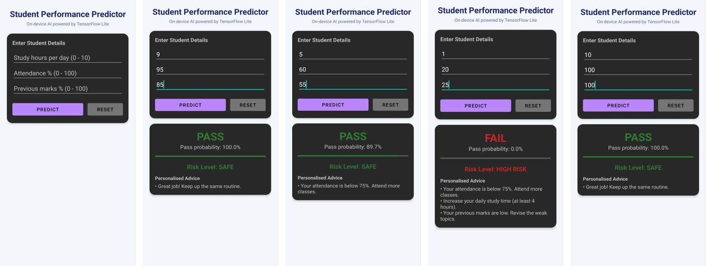

# Student Performance Predictor (TensorFlow Lite, Android)

An Android app that predicts whether a student is likely to **pass**, using a small neural network that runs **entirely on the phone** with TensorFlow Lite (no internet or server needed).

Developed for **Assignment No. 2 - Mobile App Development** (BSCS 5A, KICSIT, Kahuta Campus).

| | |
|---|---|
| **Student** | Eshal Naveed |
| **Registration No.** | 242201027 |
| **Submitted to** | Sir Uzair |

> **Acknowledgement:** This project was built starting from the provided repository
> [NumberGuessingAppTflite](https://github.com/Uzair390-Del/NumberGuessingAppTflite) by Uzair390-Del.
> Its pipeline (model in `assets`, `loadModelFile()`, `Interpreter`, `run(input, output)`) is reused. The model, layout, application logic and training script were created for this assignment.

## Screenshots



*Home screen, then four test predictions (9/95/85, 5/60/55, 1/20/25, 10/100/100).*

## Features

- On-device AI with TensorFlow Lite (works offline)
- Three inputs: study hours per day (0-10), attendance % (0-100), previous marks % (0-100)
- PASS / FAIL result with pass probability and a colour-coded progress bar
- Risk level: **Safe** (75% or more), **Moderate** (50% to below 75%), **High Risk** (below 50%)
- Personalised advice (low attendance, low study time, low previous marks)
- Input validation and a Reset button

## How it works

1. `train_model.py` generates a synthetic dataset of 2000 students, trains a Keras neural network (3 - 16 - 8 - 1) and converts it to `student_model.tflite`.
2. The model file is stored in `app/src/main/assets/`.
3. `MainActivity` loads it with `loadModelFile()` and creates a TFLite `Interpreter`.
4. On **Predict**, the inputs are scaled to 0-1 (`float[1][3]`) and `interpreter.run(input, output)` returns the probability of passing (`float[1][1]`).
5. The probability is converted to PASS/FAIL, risk level and advice and shown in the UI.

### Model

| Item | Value |
|---|---|
| Architecture | Dense(16, ReLU) - Dense(8, ReLU) - Dense(1, sigmoid), 209 parameters |
| Training | 80 epochs, Adam, binary cross-entropy, 1600 train / 400 test samples |
| Test accuracy | **93.5%** (confusion matrix `[[180, 15], [11, 194]]`) |
| Model size | **2.92 KB** |

## Project structure

```
StudentPerformancePredictorTFLite/
├── app/
│   ├── build.gradle                         # dependencies (tensorflow-lite), noCompress for .tflite
│   └── src/main/
│       ├── AndroidManifest.xml
│       ├── assets/student_model.tflite      # trained TFLite model
│       ├── java/com/example/numberguessingtflite/MainActivity.java
│       └── res/layout/activity_main.xml     # UI layout
├── docs/app_screenshots.jpg
├── train_model.py                           # training + TFLite conversion script
├── build.gradle, settings.gradle, gradle/
└── README.md
```

## Prerequisites

- Windows, macOS or Linux with **Android Studio** (recent version) and **Git**
- **JDK 17 or 21** for Gradle (JetBrains Runtime bundled with Android Studio is fine). JDK 25 is **not** compatible with Gradle 8.11.1.
- Android SDK: compileSdk 35, minSdk 24 (Android 7.0 or higher)
- An Android phone with USB debugging enabled, or an emulator
- Internet for the first Gradle sync

## Installation and running

```bash
git clone https://github.com/eshal-naveed/StudentPerformancePredictorTFLite.git
```

1. Open the cloned folder in Android Studio (**File > Open**).
2. Go to **Settings > Build, Execution, Deployment > Build Tools > Gradle** and set **Gradle JDK** to `jbr-17` or `jbr-21`.
3. Click **File > Sync Project with Gradle Files** and wait for the sync to finish.
4. Connect your phone with a USB data cable (USB debugging on) or start an emulator.
5. Select the device and click the green **Run** button.
6. Enter study hours, attendance and previous marks, then tap **Predict**.

### Example inputs

| Hours | Attendance | Prev. marks | Result |
|---|---|---|---|
| 9 | 95 | 85 | PASS, 100.0%, Safe |
| 5 | 60 | 55 | PASS, 89.7%, Safe |
| 1 | 20 | 25 | FAIL, 0.0%, High Risk |
| 10 | 100 | 100 | PASS, 100.0%, Safe |

## Dependencies

- `org.tensorflow:tensorflow-lite` (TFLite runtime and `Interpreter`)
- AndroidX AppCompat, ConstraintLayout, Material Components
- For training (Python): TensorFlow/Keras, NumPy, scikit-learn

## Retraining the model (optional)

Run `train_model.py` in Google Colab (or locally with TensorFlow installed), then replace `app/src/main/assets/student_model.tflite` with the new file. Keep the input scaling the same as in the script (hours / 10, attendance / 100, marks / 100).

## Limitations

- The training data is **synthetic**, generated from a rule chosen by the author, not collected from real students. The accuracy shows how well the model learned that rule. This app is a demonstration of on-device TFLite inference and **not** a tool for real academic decisions.
- Only three input features are used, and the advice is produced by simple rules, not by the ML model.
- The package name and app title of the original project (`numberguessingtflite`) were kept to avoid breaking the build.

## Known setup notes

- The app theme must be a Material Components theme (`Theme.MaterialComponents.DayNight.NoActionBar`), because `MaterialCardView` is used.
- `androidResources { noCompress "tflite", "lite" }` is required so the model can be memory-mapped.

## References

- Provided repository: https://github.com/Uzair390-Del/NumberGuessingAppTflite
- TensorFlow Lite: https://www.tensorflow.org/lite
- Android developer documentation: https://developer.android.com
